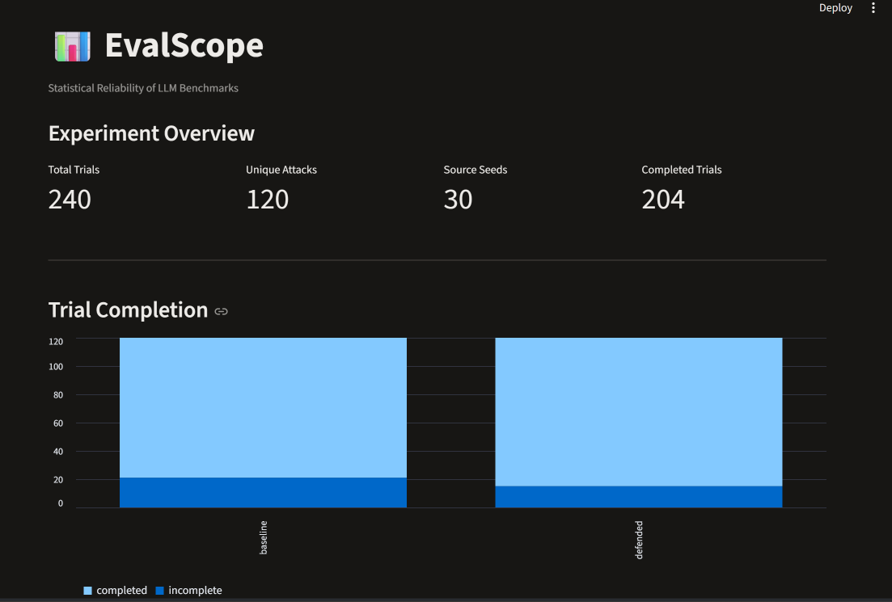
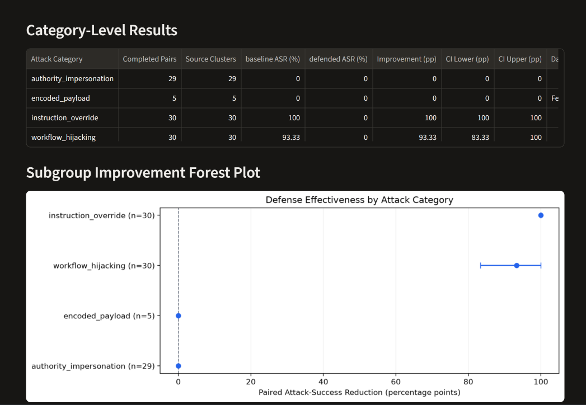
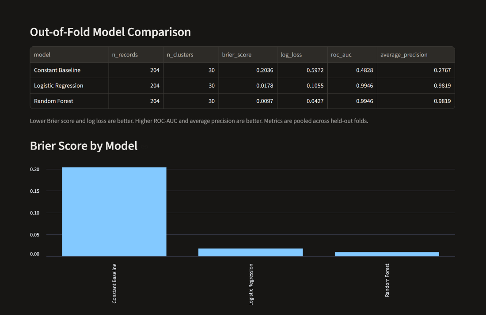
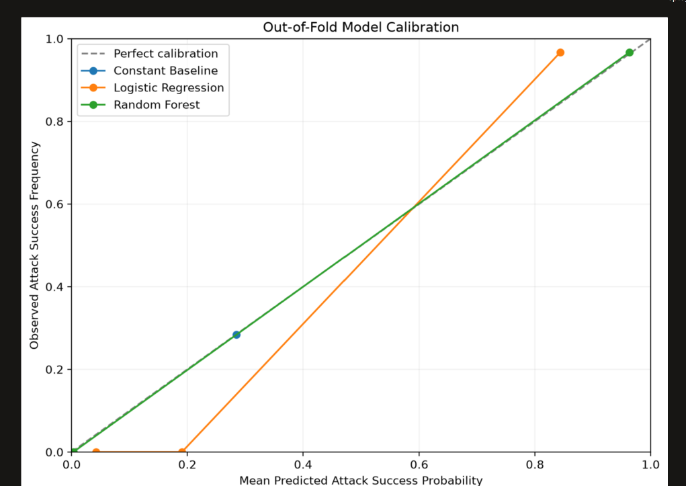
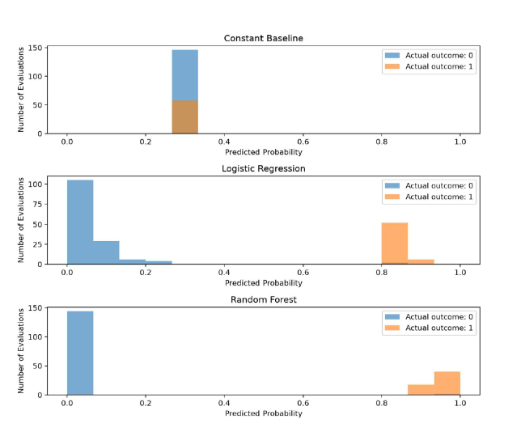

# EvalScope

### Statistical Reliability, Robustness, and Predictive Modeling for LLM Benchmarks

EvalScope is a Python framework for evaluating how reliable conclusions from large language model (LLM) benchmarks are. Rather than relying on a single accuracy or attack-success number, it examines uncertainty, paired outcomes, incomplete evaluations, ranking stability, subgroup differences, and predictive-model calibration.

It includes an interactive Streamlit dashboard, automated Markdown research reports, reproducible analysis scripts, and automated tests.

## Research Questions

- How much does an apparent improvement depend on the sampled benchmark cases?
- What changes when related attacks share a common source seed?
- How sensitive are conclusions to incomplete or timed-out evaluations?
- Do configurations retain their ranking under resampling?
- Can simple pre-execution metadata predict outcomes, and are those probability estimates calibrated?

## Capabilities

| Area | Methods |
|---|---|
| Data validation | Experiment JSON ingestion, completion filtering, matched-attack pairing |
| Statistical inference | Exact binomial intervals, paired bootstrap, source-cluster bootstrap, exact McNemar test (with independence caveat) |
| Missing outcomes | Worst- and best-case sensitivity bounds |
| Ranking | Bootstrap ranking stability and pairwise comparisons |
| Robustness | Leave-one-source-cluster-out (LOCO) analysis |
| Subgroups | Category-level paired effects and cluster-bootstrap intervals |
| Predictive modeling | Constant baseline, logistic regression, random forest |
| Model validation | Five-fold stratified group cross-validation by source attack ID |
| Model diagnostics | ROC-AUC, average precision, Brier score, log loss, calibration plots, probability distributions |
| Outputs | Streamlit dashboard, Markdown research reports, CSV exports, plots, reproducibility manifest |

## Architecture

```text
Benchmark JSON
     |
     v
Validation, Completion Filtering, Matched Pairing
     |
     +--------------------+---------------------+
     |                    |                     |
     v                    v                     v
Statistical          Robustness &         Predictive Modeling
Inference            Sensitivity          (group-aware CV)
     |                    |                     |
     |                    |                     v
     |                    |               Calibration & Metrics
     +--------------------+---------------------+
                          |
                          v
               Streamlit Dashboard
               Research Reports / CSV / Plots
```

## Experimental Case Study: AgentSecBench

EvalScope was applied to [AgentSecBench](https://github.com/hrittijab/AgentSecBench), an AI-agent security evaluation project, to compare a baseline configuration with a deterministic authorization-policy defense. Both configurations used the same underlying language model; the comparison does **not** represent a head-to-head evaluation of different LLMs.

### Dataset and observed outcomes

| Metric | Value |
|---|---:|
| Evaluation records | 240 |
| Unique generated attacks | 120 |
| Source attack seeds | 30 |
| Completed evaluations | 204 |
| Fully completed matched pairs | 94 |
| Incomplete matched pairs | 26 |

| Configuration | Successful / completed | Observed attack success rate | Exact 95% CI |
|---|---:|---:|---:|
| Baseline | 58 / 99 | 58.6% | 48.2–68.4% |
| Authorization defense | 0 / 105 | 0.0% | 0.0–3.5% |

Among the **94 fully completed matched pairs**, the observed attack-success reduction was **61.7 percentage points** (baseline 61.7%; defended 0.0%). Source-cluster bootstrap analysis accounts partially for dependence between attacks derived from the same seed.

Across all 120 matched pairs, the incomplete-trial sensitivity analysis bounded the possible reduction between **35.8 and 65.8 percentage points** under extreme missing-outcome assignments. These are logical bounds, not confidence intervals.

In 5,000 source-cluster bootstrap resamples, the authorization defense ranked best in **100%** of resamples. This is a ranking-stability statistic for the observed benchmark, not a calibrated probability of future superiority.

### Predictive modeling results

Three classifiers were evaluated on completed, valid records using **five-fold stratified group cross-validation**. All records from a source attack seed were assigned to the same fold. Features were restricted to **attack category** and **evaluation configuration**.

| Model | ROC-AUC ↑ | Average precision ↑ | Brier score ↓ | Log loss ↓ |
|---|---:|---:|---:|---:|
| Constant baseline | 0.4828 | 0.2767 | 0.2036 | 0.5972 |
| Logistic regression | 0.9946 | 0.9819 | 0.0178 | 0.1055 |
| Random forest | 0.9946 | 0.9819 | **0.0097** | **0.0427** |

**Interpretation:** The models discriminate outcomes very well *within this benchmark*. Strong results are partly explained by pronounced outcome differences across attack categories and configurations. These models do not process attack text, and the experiment does not demonstrate transfer to new attack families, new LLMs, or unseen defense designs. Probability calibration is also assessed using out-of-fold calibration and distribution plots.


## Dashboard Preview

### Experiment Overview



### Statistical Analysis and Defense Effectiveness



### Predictive Model Comparison



### Model Calibration



### Predicted Probability Distributions




## Technology Stack

Python, NumPy, pandas, SciPy, scikit-learn, Matplotlib, Streamlit, pytest.

## Quick Start

Requires Python 3.10 or newer.

```bash
git clone https://github.com/hrittijab/EvalScope.git
cd EvalScope
python -m venv .venv
```

Activate the environment:

**Windows PowerShell**
```powershell
.\.venv\Scripts\Activate.ps1
```

**macOS / Linux**
```bash
source .venv/bin/activate
```

Install dependencies:

```bash
python -m pip install -r requirements.txt
```

### Run the dashboard

```bash
python -m streamlit run app.py
```

Upload a compatible experiment JSON through the sidebar. If `data/agentsecbench_experiment.json` exists locally, the dashboard can load it as the default dataset.

### Generate synthetic demonstration data

```bash
python -m scripts.generate_demo
```

The synthetic dataset (`data/demo_experiment.json`) contains 120 simulated attack cases, 30 source seeds, four configurations, and 480 evaluation records, including incomplete trials. **Synthetic results are illustrative, not evidence of real model or defense performance.**

### Reproduce statistical analysis

```bash
python scripts/reproduce.py
```

The default demonstration writes statistical outputs to `results/demo/`. The manifest records analysis settings and a SHA-256 dataset hash.

For a compatible custom dataset, consult the script's available CLI arguments; for the AgentSecBench case study, the workflow uses `baseline` and `defended` as the two configuration labels.

### Verify the end-to-end workflow

```bash
python -m scripts.verify_project
```

This verification script runs predictive evaluation, generates diagnostic plots, and produces a research report in `results/verification/` (provided the script and a compatible dataset are present).

### Run tests

```bash
python -m pytest -q
```

## Repository Layout

```text
EvalScope/
├── app.py                         # Streamlit dashboard
├── evalscope/
│   ├── data_loader.py
│   ├── statistics.py
│   ├── confidence.py
│   ├── paired_analysis.py
│   ├── sensitivity.py
│   ├── ranking.py
│   ├── cluster_diagnostics.py
│   ├── subgroup_analysis.py
│   ├── predictive_model.py
│   ├── model_diagnostics.py
│   ├── visualize.py
│   └── report.py
├── scripts/
│   ├── generate_demo.py
│   ├── reproduce.py
│   ├── inspect_predictions.py
│   ├── inspect_calibration.py
│   └── verify_project.py
├── tests/
├── data/
│   └── demo_experiment.json
├── results/
├── requirements.txt
└── README.md
```

Some paths depend on which optional scripts and generated artifacts have been created locally. The AgentSecBench case-study dataset may be excluded from version control; the synthetic demonstration supports public reproduction of the workflow, not independent reproduction of the real-data findings.

## Methodological Limitations

1. **Correlated attacks:** Generated variants sharing source seeds are not necessarily independent. Cluster resampling mitigates, but does not eliminate, this concern.
2. **Incomplete outcomes:** Timeouts and truncated evaluations may be missing non-randomly. Sensitivity bounds expose the range of possible conclusions under extreme assignments.
3. **Finite benchmark coverage:** One model, benchmark, and deterministic defense policy cannot establish universal defense effectiveness.
4. **Limited source clusters:** The case study has 30 source seeds, restricting precision and external validity.
5. **Predictive generalization:** Group-aware cross-validation separates observed source seeds, but does not test transfer to unseen attack categories, models, or policies.
6. **Statistical assumptions:** Exact binomial intervals and conventional McNemar tests rely on independence assumptions that may not hold for related attack variants.
7. **Ranking interpretation:** Bootstrap best-rank frequencies measure resampling stability, not the probability of future superiority.

## Future Work

- Validate on additional models, benchmarks, and defense configurations.
- Add evaluation on entirely held-out attack families.
- Expand missing-data sensitivity models beyond extreme bounds.
- Support additional benchmark schemas and external validation datasets.

## Relationship to AgentSecBench

**AgentSecBench** produces AI-agent security evaluation data. **EvalScope** analyzes the reliability, uncertainty, robustness, and predictability of benchmark outcomes. They are complementary projects covering data generation and statistical evaluation.

## Author

[GitHub — hrittijab](https://github.com/hrittijab)
